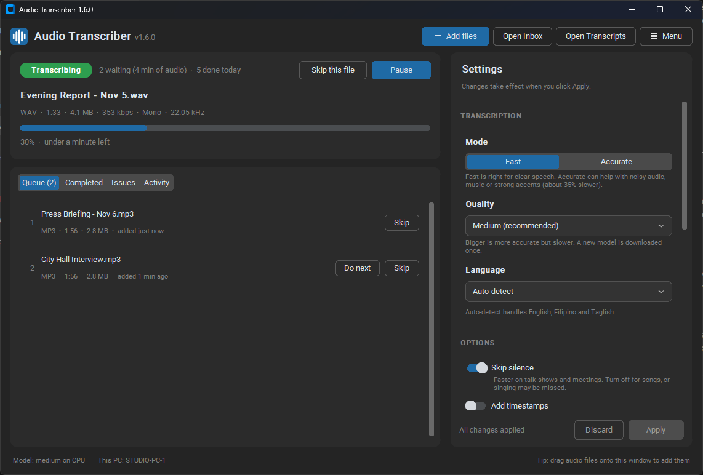
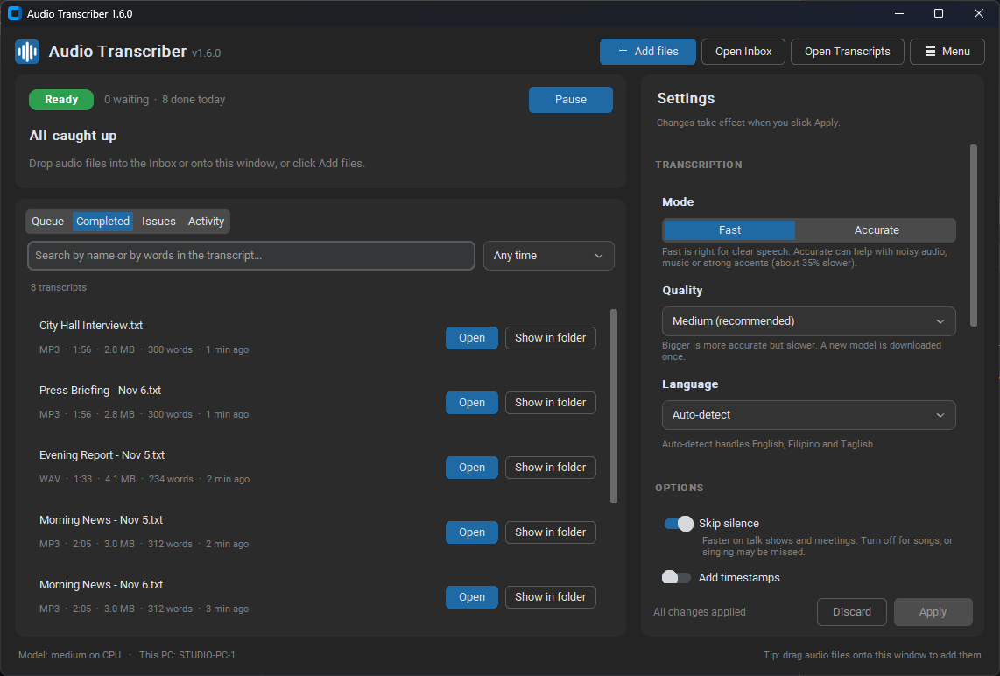
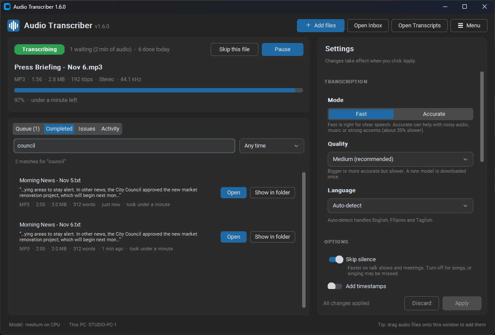
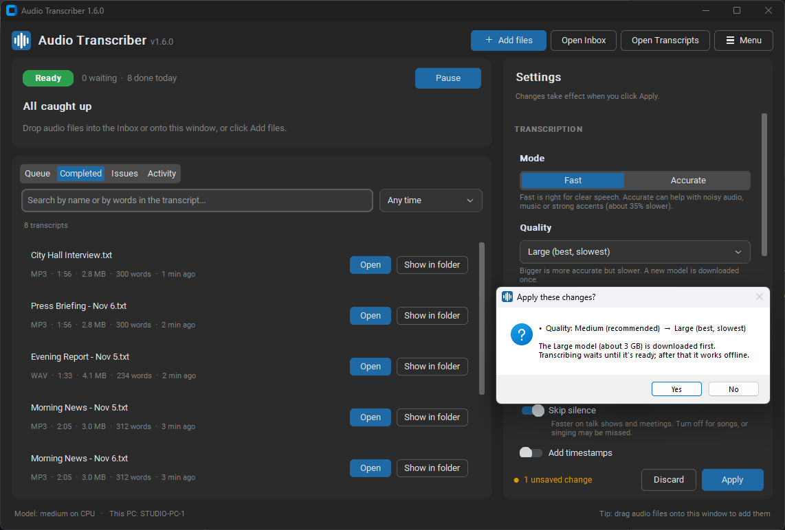

<h1 align="center">Audio Transcriber</h1>

<p align="center">
  <b>Turn audio and video files into text automatically &mdash; offline, free, on your own Windows PC.</b><br>
  Drop files into a folder, get <code>.txt</code> transcripts back. English, Filipino/Tagalog, Taglish and more.
</p>

<p align="center">
  <a href="https://github.com/pixsu/audio-transcriber/releases/latest"></a>
  <a href="https://github.com/pixsu/audio-transcriber/actions/workflows/build.yml"></a>
  
  <a href="LICENSE"></a>
</p>

<p align="center">
  <a href="https://github.com/pixsu/audio-transcriber/releases/latest"><b>&#11015;&nbsp; Download the installer</b></a>
  &nbsp;&middot;&nbsp; <a href="#getting-started">Getting started</a>
  &nbsp;&middot;&nbsp; <a href="#configuration">Settings</a>
  &nbsp;&middot;&nbsp; <a href="#troubleshooting">Troubleshooting</a>
</p>

<p align="center">
  
</p>

## Why Audio Transcriber?

- **Free and private.** Runs entirely on your PC using
  [faster-whisper](https://github.com/SYSTRAN/faster-whisper), an optimized
  version of OpenAI's Whisper. No account, API key, subscription or upload.
- **Hands-free.** Watches a folder and transcribes new files as they arrive,
  newest first, in the background (system tray).
- **Built for large archives.** Several PCs can share one network folder and
  split thousands of files between them, without ever doing a file twice.
- **Easy to use.** One window with live progress, a searchable list of
  finished transcripts, and simple switches instead of config files.

## Screenshots

<table>
  <tr>
    <td width="50%"></td>
    <td width="50%"></td>
  </tr>
  <tr>
    <td align="center"><sub><b>Completed</b> &mdash; every transcript with its source file's format, duration, size and word count</sub></td>
    <td align="center"><sub><b>Search</b> &mdash; find transcripts by name or by words inside them</sub></td>
  </tr>
  <tr>
    <td width="50%"></td>
    <td width="50%" valign="top">
      <br>
      <b>Settings you can't get wrong</b><br><br>
      Changes wait for <b>Apply</b>. Bigger decisions, such as a new model
      that needs a 3&nbsp;GB download, new folders or starting with Windows,
      explain what will happen and ask first.
    </td>
  </tr>
</table>

## Contents

- [Features](#features)
- [Requirements](#requirements)
- [Getting started](#getting-started)
- [Configuration](#configuration)
- [Large archives and long recordings](#large-archives-and-long-recordings)
- [Running on several PCs](#running-on-several-pcs)
- [Language support](#language-support)
- [GPU acceleration](#gpu-acceleration-optional)
- [Troubleshooting](#troubleshooting)
- [Updates](#updates)
- [Contributing](#contributing)
- [License](#license)

## Features

- **Simple window:** live status, a progress bar with time left, easy
  switches for every setting, and a list of recent transcripts to open
  with one click. No need to edit files by hand.
- **Runs in the background:** closing the window keeps it running in the
  system tray, with a Windows notification when each transcript is ready.
- **Hands-free:** processes everything in the input folder, then keeps
  watching it and transcribes new files as they arrive.
- **Newest first:** fresh recordings jump ahead of an existing backlog, so
  today's files don't wait behind an archive.
- **Scales across PCs:** several PCs can share one network folder and split
  the work automatically, without ever doing the same file twice.
- **Many formats:** `.mp3`, `.mp4`, `.m4a`, `.wav`, `.flac`, `.ogg`, `.opus`,
  `.webm`, `.aac`, `.wma`, `.mkv`, `.mov`. Audio is extracted from video files
  automatically.
- **Safe:** original files are only read, never modified, moved or deleted.
  Files that already have a transcript are skipped, so re-running is safe.
- **Robust:** waits until a file has finished copying before starting, and a
  corrupted file is logged and skipped without stopping the program. Only
  one copy per PC can watch a folder, so files are never processed twice.
- **Accurate on music and speech:** uses the file name as a hint for names and
  song titles, and removes lines Whisper is known to invent (such as
  *"Thanks for watching!"*).
- **Works on modest hardware:** runs on a normal CPU; uses an NVIDIA GPU
  automatically if one is set up.
- **No FFmpeg install needed:** audio decoding is built in (via PyAV).

## Requirements

- Windows 10 or 11 (64-bit)
- 4 GB RAM minimum (8 GB+ recommended for the `medium` model)
- About 1–3 GB free disk space (program + one model)
- Internet only for the first run, to download the speech model
- To build from source: **64-bit Python 3.11 or 3.12**

## Getting started

### 1. Get the program

#### Option A: Installer (easiest, no Python needed)

1. Go to the [**Releases**](https://github.com/pixsu/audio-transcriber/releases)
   page and download `AudioTranscriber-Setup-<version>.exe` from the latest
   release.
2. Run it and click through. It needs **no administrator rights**: it
   installs for your Windows account into
   `%LOCALAPPDATA%\Programs\Audio Transcriber`, adds a Start Menu entry and
   (optionally) a desktop shortcut, and can start the program when you log in.
3. Start **Audio Transcriber** from the Start Menu and continue with
   [Run it](#2-run-it).

**Updating:** run the newer installer. It closes the running program first,
replaces the program files and keeps your settings, log and downloaded
models. The program also tells you when a new version is out (see
[Updates](#updates)).

**Uninstalling:** *Settings → Apps → Installed apps → Audio Transcriber →
Uninstall*. This removes the program, its settings and its downloaded
models. Your Inbox and Transcripts folders are never touched.

#### Option A2: Portable zip

Download `AudioTranscriber-<version>-windows-x64.zip` instead, unzip it
anywhere (e.g. a USB drive or a shared folder) and double-click
`AudioTranscriber\AudioTranscriber.exe`. Settings and models are kept in that
folder.

> The program is not code-signed, so Windows may show *"Windows protected
> your PC"* the first time. Click **More info → Run anyway**. Every release is
> built automatically from this repository's source code by GitHub Actions.

#### Option B: Build from source

1. Install **64-bit Python 3.11 or 3.12** from
   [python.org](https://www.python.org/downloads/). During setup, tick
   **"Add python.exe to PATH"**.
2. Download this repository (**Code → Download ZIP**, then unzip), or clone it:
   ```bash
   git clone https://github.com/pixsu/audio-transcriber.git
   ```
3. Double-click **`build.bat`**. It creates a virtual environment, installs the
   dependencies and builds the program. This takes a few minutes.

When it finishes you will have:

| Output | What it is |
|---|---|
| `dist\AudioTranscriber\` | The program folder. Run `AudioTranscriber.exe` inside it. |
| `dist\AudioTranscriber.zip` | A clean copy of that folder to give to other PCs (no Python needed there). |

> Keep `AudioTranscriber.exe` and the `_internal` folder next to it together.
> To move the program, move the whole `AudioTranscriber` folder.

### 2. Run it

1. Double-click `dist\AudioTranscriber\AudioTranscriber.exe`.
2. On the first run it:
   - creates two folders in **your Documents folder**:
     `Documents\Audio Transcriber\Inbox` (put files here) and
     `Documents\Audio Transcriber\Transcripts` (transcripts appear here);
   - creates a `config.json` settings file next to the .exe;
   - downloads the speech model (`small` ≈ 480 MB, `medium` ≈ 1.5 GB) into a
     `models` folder next to the .exe. After that it works offline.
3. Add files: drag them onto the window, click **Add audio files...**, or
   copy them into the `Inbox` folder yourself.
4. The window shows what's happening:

   | Area | What it does |
   |---|---|
   | **Top bar** | **Add files**, **Open Inbox**, **Open Transcripts**, and **Menu** (log file, config.json, Retry all, About, Quit). |
   | **Status card** | Ready / Transcribing / Paused / Loading model / Needs attention, files waiting, done today. The current file with its details (format, duration, size, bitrate, mono/stereo, sample rate), a progress bar and time left. **Pause / Resume** and **Skip this file**. If something is wrong (e.g. a folder can't be reached) it says what and shows **Try again**. |
   | **Queue** tab | Files waiting, in the order they will be done, each with its format, duration and size (the status line also shows the total audio waiting). **Do next** moves a file to the front; **Skip** takes it out of the queue. New files show up within seconds, even during a long file. |
   | **Completed** tab | A search box (file name or any words inside the transcript, with the matching sentence shown) and a date filter (Today, Last 7 days, Last 30 days). Finished transcripts (from any PC sharing the folder) with the original file's format, duration and size, the word count, **Open** and **Show in folder**. |
   | **Issues** tab | Files that failed or were skipped, with the reason. **Retry** or **Retry all**. |
   | **Activity** tab | A live log; warnings in amber, errors in red. |
   | **Settings** panel | Easy switches; see [Configuration](#configuration). Changes wait until you click **Apply** (or **Discard** to undo them). **Reset to defaults** selects the default values for everything except your folders. |
   | **Status bar** | The loaded model (e.g. *medium on CPU*), this PC's name, and files being copied in. |

   Shortcuts: **Ctrl+O** add files, **Ctrl+Q** quit.

5. Each file gets a transcript with the same name: `meeting1.mp3` →
   `meeting1.txt`. If two files share a name (e.g. `song.mp3` and
   `song.mp4`), the second one gets `song.mp4.txt` so neither is skipped or
   overwritten. (This is tracked in a small hidden file,
   `.transcriber-index.json`, in the output folder.)
6. **Closing the window keeps it running** in the system tray (the blue
   sound-wave icon next to the clock; it may be under the **^** arrow).
   Double-click the icon (or just start the program again) to bring the window back. To stop completely,
   right-click the icon → **Quit**. A file that was half done is simply
   started again next time.

Tip: switch on **Start with Windows** in the settings to have it start
hidden in the tray whenever you log in.

#### Console mode (servers, scripts)

The old text-only mode is still there. Run it from a command prompt:

```bat
AudioTranscriber.exe --console
```

It reads the same `config.json`. Stop it with **Ctrl+C**.

## Configuration

Most settings can be changed in the window's **Settings** panel. Nothing
changes until you click **Apply**; the panel shows how many changes are
waiting, and **Discard** puts everything back.

Changes with bigger effects ask for confirmation first and explain what
will happen: a new **Quality** (model), which may mean a download of up to
3 GB; a different **Device**; new **folders**; and **Start with Windows**.

Applied settings are saved to `config.json` and take effect from the next
file (the file being transcribed finishes with the old settings). Quitting
with unapplied changes asks whether to apply them.

| In the window | Setting in `config.json` |
|---|---|
| Mode: Fast / Accurate | `speed` |
| Quality | `model_size` |
| Language | `language` |
| Order | `order` |
| Skip silence | `vad_filter` |
| Add timestamps | `include_timestamps` |
| Label music and songs | `label_music` |
| Use file name as a hint | `use_filename_hint` |
| Folders → Change | `input_folder`, `output_folder` |
| Device | `device` |

The remaining settings (`file_types`, `poll_interval_seconds`) are
only in `config.json`; restart the program after editing it by hand.

```json
{
    "input_folder": "C:\\Users\\YourName\\Documents\\Audio Transcriber\\Inbox",
    "output_folder": "C:\\Users\\YourName\\Documents\\Audio Transcriber\\Transcripts",
    "model_size": "small",
    "language": "auto",
    "include_timestamps": false,
    "label_music": false,
    "vad_filter": true,
    "use_filename_hint": true,
    "file_types": [".mp3", ".mp4", ".m4a", ".wav", ".flac", ".ogg", ".opus",
                   ".webm", ".aac", ".wma", ".mkv", ".mov"],
    "speed": "fast",
    "order": "newest_first",
    "poll_interval_seconds": 10,
    "device": "auto"
}
```

| Setting | Default | Description |
|---|---|---|
| `input_folder` | `Documents\Audio Transcriber\Inbox` | Folder to read audio/video files from. Subfolders are not scanned. Created if missing. |
| `output_folder` | `Documents\Audio Transcriber\Transcripts` | Folder to save `.txt` transcripts to. Created if missing. |
| `model_size` | `small` | `tiny`, `base`, `small`, `medium`, `large-v3-turbo` or `large-v3`. Larger is more accurate but slower and uses more memory. See [Choosing a model](#choosing-a-model). |
| `language` | `auto` | `auto` detects the language. Or force one with a code, e.g. `en` (English) or `tl` (Tagalog). |
| `include_timestamps` | `false` | `true` writes lines like `[00:01:23 → 00:01:30] text here`. |
| Names to spell right | — | Stations, hosts, sponsors, places; given to Whisper as hints. Edit in **Settings → Vocabulary**. Keep it to real names: common words in the list can be wrongly inserted. Stored in `.vocabulary.json` in the Transcripts folder, so every PC sharing that folder uses the same list. |
| Jingle library | — | Station jingles, IDs, ads and songs are the same recording every time they air. Correct one once: open a transcript, select its lines, right-click → **Save as jingle / ad / song**, choose the type and fix the text (keep each line's `[time]` to save it line by line, best for songs). From then on it's recognised in every new file (`[JINGLE 00:00:45 → 00:01:23] your text`, or one `[SONG …]` line per lyric line) and not transcribed. Matching works in 8-second pieces, so songs cut short or talked over still match on their clean parts. Stored in `.jingles` inside the Transcripts folder, so PCs sharing that folder share the library. Manage in **Settings → Vocabulary → Jingles and ads**. |
| Fixes | — | `wrong = right` fixes applied to every line (whole words, any capitals), e.g. `Love rate = Love Radio`. Add them in **Settings → Vocabulary** or by right-clicking a word in a transcript → **Correct** → **Always**. Shared like the names, in `.vocabulary.json`. |
| `label_music` | `false` | `true` puts `MUSIC` in front of lines where music or singing dominates (songs, jingles), e.g. `[MUSIC 00:01:23 → 00:01:30] lyrics`, or `[MUSIC] lyrics` without timestamps. Everything is still transcribed; talk over a music bed stays unlabelled. With this on, **Skip silence** is not used (it drops singing); instead only true dead air (no sound for 10 seconds or more) is skipped and marked, e.g. `[SILENCE 00:52:40 → 01:00:30]`. Uses a small sound classifier (YAMNet, 14 MB, downloaded once into `models\yamnet`) and adds only a few seconds per hour of audio. |
| `vad_filter` | `true` | Skips silence. Good for speech; **set to `false` for music** (see below). |
| `use_filename_hint` | `true` | Passes the cleaned file name (e.g. `Artist Song Title`) to the model to help it spell names and titles. |
| `file_types` | (list above) | File extensions to pick up. |
| `speed` | `fast` | `fast` takes the model's single best guess at each step (about 35% faster; no accuracy loss on clear speech in testing). `accurate` compares 5 guesses, which can help with noisy audio, music or strong accents. |
| `order` | `newest_first` | Which waiting file to do next: `newest_first` (fresh recordings first), `oldest_first`, or `name` (alphabetical). The folder is re-checked after every file, so a new file goes next even during a long backlog. |
| `poll_interval_seconds` | `10` | How often to check the input folder for new files. |
| `device` | `auto` | `auto` uses an NVIDIA GPU if available, otherwise the CPU. Force with `cuda` or `cpu`. |

### Recommended settings

| Use case | `model_size` | `vad_filter` | Notes |
|---|---|---|---|
| News, talk shows, interviews, meetings | `medium` + `"speed": "fast"` | `true` | ~19 min per hour of audio on a modern PC, or less when there are pauses. |
| Songs and music | `medium` | `false` | The silence filter treats singing over music as "not speech" and would drop most of the song. |
| Low-end PC | `small` + `"speed": "fast"` | either | The fastest setup that is still accurate on clear speech. |

If the silence filter removes more than half of a file, the program prints a
warning suggesting `"vad_filter": false`.

### Choosing a model

Speed on a 4-minute song, measured on an Intel Core i7-12700F (CPU only):

| Model | Download size | Time | Accuracy |
|---|---|---|---|
| `small` | ~480 MB | ~30 s | Good. Best choice for low-end PCs. |
| `medium` | ~1.5 GB | ~70–100 s | Better, especially for lyrics and non-English audio. |
| `large-v3-turbo` | ~1.6 GB | ~1.3× medium | Best for radio: clearer names, ads and lyrics. Lines are longer (often 10–25 s each). |

Slower CPUs will take proportionally longer. On a 15-minute Filipino FM
radio test (songs, ads, DJ talk) `large-v3-turbo` took 5.7 min against
4.5 min for `medium`, and spelled sponsors and lyrics noticeably better
(e.g. "Birch Tree Advanced", "Unique with PLDT Home Fiber Prepaid").

## Large archives and long recordings

Files of any length work; a 1-hour recording needs about 250 MB of memory
while it is processed. Speed on spoken audio (news-style speech), measured on
an Intel Core i7-12700F, CPU only:

| Setup | 1-hour file | 1,000 hours of audio | Word errors (clear speech) |
|---|---|---|---|
| `medium`, `speed: accurate` | ~29 min | ~3 weeks non-stop | 0% |
| **`medium`, `speed: fast`** (default speed) | **~19 min** | **~2 weeks non-stop** | **0%** |
| `small`, `speed: accurate` | ~15 min | ~10 days non-stop | 1.1% |
| `large-v3-turbo`, `speed: fast` | ~16 min | ~11 days non-stop | 1.1% (but fails on music) |

Measured on a 5-minute news-style recording of clear speech. Real broadcasts
(callers, background music, Taglish) may show slightly more errors, and
office PCs slower than an i7-12700F will take longer.

Running several files at once on the same PC does **not** help (the CPU is
already fully used). To go faster:

- **Add PCs.** Each extra PC adds its full speed; see
  [Running on several PCs](#running-on-several-pcs).
- **Use a GPU.** An NVIDIA GPU is typically many times faster than a CPU; see
  [GPU acceleration](#gpu-acceleration-optional).
- **Use `small` for bulk archive work** and `medium` where accuracy matters
  most.

If the program is closed in the middle of a file, that file starts again from
the beginning next time.

## Running on several PCs

Several PCs can work through the same folders together, for example a shared
folder on a file server:

1. Put the input and output folders on a network share that every PC can
   reach, with read access to the input folder and write access to the
   output folder.
2. On each PC, unzip the program and set the **same** `input_folder` and
   `output_folder` in its `config.json`. Network paths work; double the
   backslashes:
   ```json
   "input_folder": "\\\\fileserver\\recordings\\to_transcribe",
   "output_folder": "\\\\fileserver\\recordings\\transcripts",
   ```
3. Start the program on each PC. Use the same `model_size` and `language` on
   all PCs so transcripts are consistent.

How the PCs share the work:

- Before starting a file, a PC creates a hidden claim file
  (`<name>.txt.inprogress`) in the output folder. Creating it is atomic, so
  only one PC can claim a file; the others skip it and take the next one.
- While working, the PC refreshes its claim every 30 seconds. If a PC crashes,
  loses power or is closed, its claim stops being refreshed and another PC
  takes the file over after 10 minutes. The same PC restarting resumes its
  own unfinished file immediately.
- Each PC keeps its own `transcriber.log`; the "This PC:" line at startup
  shows its name, and takeovers are logged with the name of the PC that
  stopped.

### Tips for better accuracy

- **Name files descriptively.** `Artist - Song Title.mp3` gives the model a
  useful hint. Downloader junk such as `ytmp4`, `savetube` or
  `(Official Video)` is removed automatically.
- **Use `medium`** if your PC can handle it.
- **Set `language`** if all your files are in one language and auto-detect
  gets it wrong.
- **Never force `"en"` for non-English audio.** Whisper may translate it into
  English instead of transcribing it.

## Language support

Whisper supports about 99 languages. Philippine languages in particular:

| Language | Support | Notes |
|---|---|---|
| English | Excellent | |
| Tagalog / Filipino | Good | Works with `auto` or `"tl"`. Use `medium` for best results. Taglish (mixed Tagalog and English) works with `auto`. |
| Cebuano / Bisaya, Ilocano, Hiligaynon, Waray | Partial | Not in Whisper's language list. Expect a rough draft: shared and borrowed words are usually correct, but language-specific words may be misspelled. Try both `auto` and `"tl"` and keep whichever reads better. |

## GPU acceleration (optional)

With `"device": "auto"`, an NVIDIA GPU is used automatically if the required
libraries are present. The startup message shows what was picked:
`Model loaded on GPU (CUDA, float16)` or `Model loaded on CPU (int8)`.

The GPU needs **CUDA 12 cuBLAS** and **cuDNN 9** plus an up-to-date NVIDIA
driver. They are not bundled with the program. Either:

- **Easiest:** download the CUDA 12 cuBLAS + cuDNN pack from
  [Purfview/whisper-standalone-win](https://github.com/Purfview/whisper-standalone-win/releases/tag/libs)
  and extract the `.dll` files next to `AudioTranscriber.exe` (or into a `cuda`
  folder next to it), **or**
- install the [CUDA Toolkit 12](https://developer.nvidia.com/cuda-downloads)
  and [cuDNN 9](https://developer.nvidia.com/cudnn) and add their `bin`
  folders to your PATH.

The required files are `cublas64_12.dll`, `cublasLt64_12.dll` and the
`cudnn*64_9.dll` files. If they are missing, the program falls back to the CPU
and keeps working.

## Troubleshooting

| Problem | Solution |
|---|---|
| A file is ignored | Check its real extension: Windows hides extensions by default, so a `.mp4` can look like an MP3. Enable *View → Show → File name extensions* in Explorer and make sure the extension is in `file_types`. |
| Only part of a song is transcribed | Turn off **Skip silence** (`"vad_filter": false`). |
| `config.json is not valid JSON` | Paths need double backslashes (`C:\\Users\\...`), and every line except the last needs a comma. |
| A file failed | The error is shown in the Activity box (and a notification) and saved in `transcriber.log`. Failed files are not retried unless the file changes; restart the program to retry. |
| "Another copy of the transcriber is already watching..." | The program is already running. Look for its icon in the system tray next to the clock (maybe under **^**), right-click it → **Quit**. |
| A transcript should be redone | Delete its `.txt` file; it is transcribed again within one check. |
| Very slow | Choose **Mode: Fast** or a smaller **Quality**, or set up a GPU. |
| No tray icon | Click the **^** arrow next to the clock; Windows hides new tray icons there. Drag it out to keep it visible. |
| `GPU could not be used` | The CUDA libraries are missing; see [GPU acceleration](#gpu-acceleration-optional). |
| Antivirus warning | Unsigned programs built with PyInstaller are sometimes flagged by mistake. Building it yourself from this source avoids trusting a third-party binary. |
| Transcript has odd lines in instrumental parts | Whisper sometimes guesses words during music. Common fake lines are removed automatically; others can be deleted by hand. |

Logs are written to `transcriber.log` next to the .exe, including full error
details. The log is capped at 1 MB; older entries move to
`transcriber.log.1` to `.3`, so it never grows without limit.

## Running from source

After running `build.bat` once (to create `.venv`), you can run the script
directly without building:

```bat
.venv\Scripts\python.exe app.py                   (window)
.venv\Scripts\python.exe transcriber.py            (console)
```

When run this way, `config.json`, `transcriber.log` and `models\` are created
next to the scripts.

## Project structure

```text
app.py                  The window, tray icon and settings panel
transcriber.py          The transcription engine (also runs on its own in a console)
music_detect.py         Finds music parts for the "Label music and songs" setting
jingles.py              Jingle library: recognises jingles and ads that air again and again
requirements.txt        Top-level Python dependencies (loose versions)
requirements-lock.txt   Exact tested versions, used by build.bat
build.bat               One-click build script (venv + install + PyInstaller + installer)
installer.iss           Inno Setup script for AudioTranscriber-Setup.exe
README.md               This file
CHANGELOG.md            What changed in each version
CONTRIBUTING.md         How to run from source and send changes
SECURITY.md             How to report security problems; what data is used
LICENSE                 MIT license
docs/images/            Screenshots used in this README
.github/workflows/      Automatic build, test and release on GitHub
.github/ISSUE_TEMPLATE/ Bug report and feature request forms
.gitignore              Keeps build output, models and personal settings out of git
.gitattributes          Keeps build.bat in Windows line endings
```

Generated (not in git): `.venv\`, `build\`, `dist\`, and at runtime
`config.json`, `transcriber.log` and `models\`.

## Build details

`build.bat` builds into `build\staging` first and then copies the program files
into `dist\AudioTranscriber`, so rebuilding never deletes your downloaded
models, settings or log. It runs:

```bat
pyinstaller --noconfirm --clean --onedir --windowed --name AudioTranscriber ^
    --icon build\icon.ico --distpath build\staging ^
    --collect-all faster_whisper --collect-all ctranslate2 ^
    --collect-all onnxruntime --collect-all av --collect-all tokenizers ^
    --collect-all customtkinter --collect-all tkinterdnd2 ^
    --hidden-import pystray._win32 ^
    --copy-metadata faster-whisper --copy-metadata huggingface_hub ^
    --copy-metadata tokenizers --copy-metadata tqdm --copy-metadata numpy ^
    app.py
```

The icon (`build\icon.ico`) is drawn by `app.py` itself, so there is no image
file to keep in the repository.

- `--collect-all` bundles the DLLs, compiled modules and data files (such as
  the Silero VAD model) that PyInstaller cannot detect on its own.
- `--copy-metadata` keeps package version information some libraries check at
  runtime.
- `--onedir` (a folder) is used instead of `--onefile`: a single-file .exe
  unpacks itself to the Temp folder on every start, which is slower and leaves
  large leftovers behind if the program is closed abruptly.
- Dependencies are installed from `requirements-lock.txt` (exact versions), so
  every build uses the same tested packages. A new release of any library
  can't silently break the build. For example, PyAV 15+ breaks
  faster-whisper's audio loading, so it is held at 14.2.0.
- To update dependencies: install `requirements.txt` into a fresh `.venv`, test
  the app, then regenerate the lock file with
  `.venv\Scripts\python.exe -m pip freeze > requirements-lock.txt`
  (remove the `pip` and `setuptools` lines).

## Updates

When it starts and then every hour, the program checks the
[Releases](https://github.com/pixsu/audio-transcriber/releases) page. When
there is a newer version, a Windows notification pops up once (useful when
the program is in the tray) and a blue notice appears at the top of the window
with **Update now**, **What's new** and **Later** (hides the notice until
the next version).

**Update now** downloads the installer from this repository's release,
checks its SHA-256 fingerprint (published with every release) and installs
it silently. The program closes for a few seconds and reopens on the new
version, keeping your settings and models. If a file is being transcribed,
the update waits until it's done (or click **Install now**). Copies run
from the zip or from source get a **Download** button instead. You can also check any time with
**Menu → Check for updates**, or turn the automatic check off with the
**Check for updates** switch in Settings.

The check only reads the public release information; nothing about you or
your files is sent. It needs internet access and a public repository.

## Releases (for maintainers)

Builds run automatically on GitHub (free) using
[`.github/workflows/build.yml`](.github/workflows/build.yml):

- **Every push to `main`** that changes the app builds it, runs a quick test
  (the built .exe transcribes a short test file), and keeps the zip for 30
  days under *Actions → the run → Artifacts*.
- **Publishing a release:**
  1. Bump `__version__` in `transcriber.py` (e.g. `1.0.1`).
  2. Add a section for it at the top of `CHANGELOG.md`.
  3. Commit and push, then tag and push the tag:
     ```bash
     git tag v1.0.1
     git push origin v1.0.1
     ```
  The workflow checks the tag matches `__version__`, builds and tests the
  program, and creates a GitHub Release with
  `AudioTranscriber-Setup-1.0.1.exe` and `AudioTranscriber-1.0.1-windows-x64.zip`
  attached and the changelog section as release notes.

To build the installer locally, install the free
[Inno Setup 6](https://jrsoftware.org/isinfo.php); `build.bat` then also
creates `dist\AudioTranscriber-Setup.exe` (it skips this step otherwise).

## Contributing

Bug reports, ideas and pull requests are welcome. See
[CONTRIBUTING.md](CONTRIBUTING.md) for how to run the app from source and
send changes, and use the
[issue templates](https://github.com/pixsu/audio-transcriber/issues/new/choose)
to report a problem or suggest a feature. Security issues: see
[SECURITY.md](SECURITY.md).

## License

This project is licensed under the [MIT License](LICENSE).

The release download bundles third-party components under their own licenses,
including faster-whisper and CTranslate2 (MIT), PyAV (BSD), FFmpeg libraries
inside PyAV (LGPL), ONNX Runtime (MIT) and Python (PSF). The Whisper models
downloaded on first run are released by OpenAI under the MIT License.

## Acknowledgements

- [faster-whisper](https://github.com/SYSTRAN/faster-whisper) by SYSTRAN
- [Whisper](https://github.com/openai/whisper) by OpenAI
- [CTranslate2](https://github.com/OpenNMT/CTranslate2),
  [PyAV](https://github.com/PyAV-Org/PyAV) and
  [PyInstaller](https://pyinstaller.org/)
